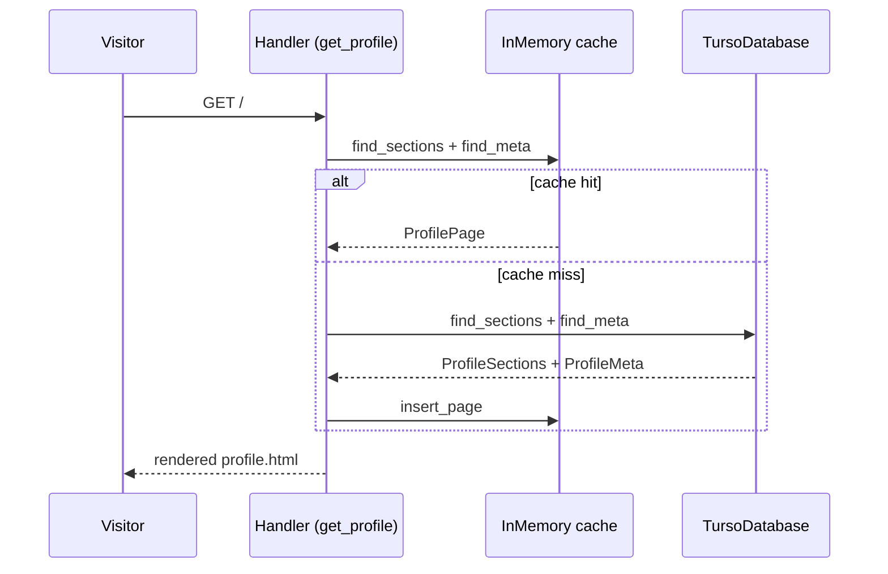
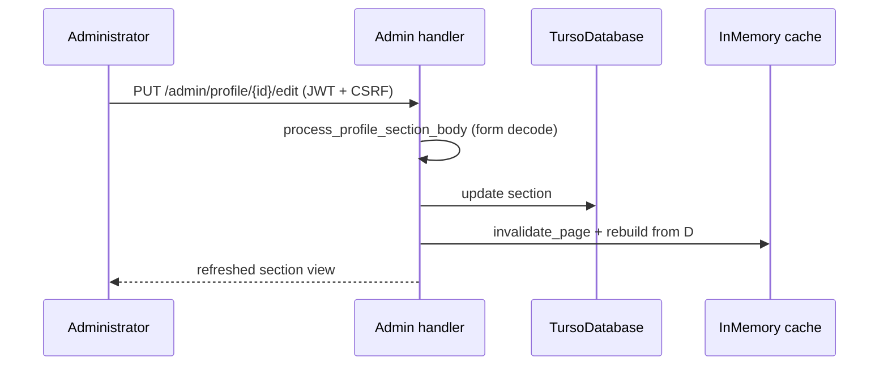

# Admin-editable Profile page sections

## Goals
The Profile page (`/`) was a hardcoded Askama template. This feature moves its
content into the database so the Administrator can add, remove, edit, and
reorder sections through the Admin area, without a code change.

## Criterias
- The Profile page renders an ordered list of Profile Sections stored in the
  `profile_sections` table (columns: `id`, `position`, `title`, `body`,
  `layout`).
- Section bodies are markdown, converted to sanitized HTML with
  `convert_markdown_to_html` (Ammonia; also permits `target="_blank"` on
  `<a>`).
- Each section has a Layout (`stacked` or `cards`). `cards` wraps the body in
  a `flex-container` grid; unknown values fall back to `stacked`.
- The section with the lowest `position` is the page title section: it renders
  no heading, provides the page `<title>` (from its markdown h1), and is
  protected from deletion (delete attempts re-render the admin list with an
  error notice).
- The page meta description lives in a single-row `profile_meta` table and is
  editable in the Admin area.
- Seeding: on startup, if `profile_sections` or `profile_meta` is empty, the
  former hardcoded content is inserted (`PROFILE_SECTIONS_SEED` and
  `PROFILE_META_SEED` in `src/database/turso/profile.rs`). Seeding is
  idempotent.
- Public `/` behavior: cache → database → 500 on database error; zero
  sections render the page shell with no content. No hardcoded fallback.
- Admin area `/admin/profile`: list (meta zone + ordered sections with
  up/down move buttons), add, view, edit (markdown textarea + layout dropdown
  + server-side preview), delete (title-protected), meta description edit.
  Preview is a POST that renders the textarea content without touching the
  database; it requires authentication and CSRF like all mutations.
- Section add appends at the end; move swaps positions with the adjacent
  neighbor; delete leaves position gaps (only relative order matters).

## Usage
No new environment variables. Reuses `DATA_SOURCE` (SQLite/Turso),
`CACHE_TYPE`/`CACHE_TTL` for the profile page cache, and JWT/CSRF auth as in
the rest of the Admin area.

Known limitation / TODO: the shared page shell (footer social links, email,
quote) is still hardcoded in `templates/base.html` and
`templates/admin/admin_base.html`. Making it Administrator-editable is future
work and out of scope of this feature.

TODO: expose per-section layout control beyond `stacked`/`cards` (e.g.
arbitrary CSS classes) only if a real need appears; currently constrained to
the two-value Layout enum by design.

## Flow

### Viewing the Profile page

### Editing a section

## References
- [ADR-0005 Sanitize authored HTML](../docs/adr/0005-sanitize-authored-blog-html.md)
- [ADR-0007 Process-local moka cache](../docs/adr/0007-process-local-moka-cache.md)
- `src/handler/admin/profile/` (Admin handlers), `src/usecase/profile.rs`,
  `src/repo/profile.rs`, `src/database/turso/profile.rs`,
  `src/cache/inmemory/profile.rs`
